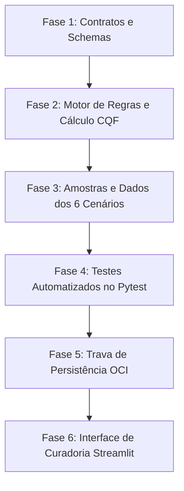

# 📋 Plano de Implementação: CommunityLab Quality Framework (CQF v1.0)

**Projeto:** CommunityLab — Detector Inteligente de Histórias de Sucesso e Testemunhos  
**Hackathon:** ONE G10 — Oracle Next Education & Alura (Equipe 18)  
**Base Normativa:** Especificação Funcional CQF v1.0 & Relatório de Validação Metodológica v1.0 (Marcus — PM)  
**Responsável Técnico pela Proposta:** Ketlyn Barbosa (*Machine Learning Engineer*)  
**Status:** Proposta de Execução Técnica  

---

## 🎯 1. Objetivo do Plano

Transformar a metodologia conceitual do **CQF v1.0** e suas regras de governança (**RG-01**, **RG-02**, **RG-03**) em componentes de software testáveis, tipados e integrados ao ecossistema do CommunityLab, garantindo:
1. **Rigor Matemático:** Cálculo automatizado do CQF Score e faixas de prioridade editorial.
2. **Governança Estrita:** Travas programáticas de validação factual e autorização de publicação.
3. **Interoperabilidade:** Novos contratos de dados (JSON Schema e Pydantic v2) compatíveis com OCI e Streamlit.
4. **Demonstrabilidade:** Suíte de testes unitários baseada nos 6 cenários validados (CQF-001 a CQF-003 e CQF-NEG-001 a CQF-NEG-003).

---

## 🏗️ 2. Fases de Execução



---

### 🔹 Fase 1: Modelagem de Dados e Contratos Formais

#### 1.1. Ajuste em Ativos Gerados ([`schemas/ativo_gerado_schema.json`](file:///home/ketlyn/Desktop/Desktop/communitLab_Oficial/G10-Brasil-Equipe-18/schemas/ativo_gerado_schema.json) e [`src/modelos.py`](file:///home/ketlyn/Desktop/Desktop/communitLab_Oficial/G10-Brasil-Equipe-18/src/modelos.py#L73))
- **Problema:** O schema só aceita `"post_linkedin"` e `"resumo_newsletter"`, enquanto o CQF define como formatos principais do MVP: **Testemunho estruturado** e **Case de sucesso**.
- **Entrega:**
  - Atualizar o enum de tipos no schema e no Pydantic para:
    `["testemunho_estruturado", "case_sucesso", "post_linkedin", "resumo_newsletter"]`
  - Adicionar o campo opcional `id_avaliacao_cqf: Optional[str] = None` para rastreabilidade cruzada.

#### 1.2. Criação do Schema CQF ([`schemas/avaliacao_cqf_schema.json`](file:///home/ketlyn/Desktop/Desktop/communitLab_Oficial/G10-Brasil-Equipe-18/schemas/avaliacao_cqf_schema.json))
- Criar o JSON Schema Draft 2020-12 contendo os campos da Seção 8 do documento CQF:
  - `id_avaliacao` (`pattern: ^cqf_[0-9]{3,}$`)
  - `id_historia` (`pattern: ^historia_[0-9]{3,}$`)
  - `id_ativo` (opcional)
  - `versao_framework` (`const: 1.0`)
  - Notas de 0 a 5 (`nota_relevancia`, `nota_completude`, `nota_clareza_impacto`, `nota_evidencias`)
  - `cqf_score` (número de 0 a 100)
  - `classificacao_editorial` (`enum: ["alta_prioridade", "prioridade_media", "baixa_prioridade"]`)
  - `status_validacao_factual` (`enum: ["conforme", "evidencias_insuficientes", "contradicao_detectada"]`)
  - `status_curadoria` (`enum: ["pendente", "aprovado", "rejeitado", "solicitar_ajustes"]`)
  - `status_autorizacao_publicacao` (`enum: ["pendente", "autorizada", "negada", "nao_aplicavel"]`)
  - `responsavel_avaliacao`, `data_avaliacao`, `observacoes`

#### 1.3. Modelo Pydantic [`AvaliacaoCQF`](file:///home/ketlyn/Desktop/Desktop/communitLab_Oficial/G10-Brasil-Equipe-18/src/modelos.py)
- Implementar a classe `AvaliacaoCQF` em `src/modelos.py` com validações de intervalos (`ge=0`, `le=5`), cálculo automático ou validação de consistência do score e das regras de governança.

---

### 🔹 Fase 2: Motor de Regras e Cálculo CQF (`src.orchestration.cqf`)

Criar o módulo dedicado `src/orchestration/cqf.py` contendo as funções puras de regras de negócio:

#### 2.1. Função de Cálculo do CQF Score
```python
def calcular_cqf_score(
    relevancia: float,
    completude: float,
    clareza_impacto: float,
    evidencias: float
) -> Dict[str, Any]:
    """
    Calcula: (R * 0.25 + C * 0.25 + I * 0.20 + E * 0.30) * 20
    Retorna score arredondado (0-100) e classificação editorial.
    """
```
- **Faixas:**
  - $\ge 80$: `"alta_prioridade"`
  - $60 \text{ a } 79$: `"prioridade_media"`
  - $< 60$: `"baixa_prioridade"`

#### 2.2. Implementação das Regras de Governança
- **RG-01 (Integridade das Evidências):**
  - Função `validar_integridade_citacoes(historia: HistoriaDetectada, interacoes: List[Interacao]) -> Tuple[bool, List[str]]`
  - Checa se cada citação literal atribuída a `id_interacao` existe textualmente na mensagem de origem.
- **RG-02 (Consistência Factual):**
  - Função `avaliar_aprovacao_editorial(status_validacao_factual: str, status_curadoria: str) -> Tuple[bool, str]`
  - Bloqueia aprovação se houver contradição não resolvida (`contradicao_detectada`).
- **RG-03 (Trava de Publicação):**
  - Função `validar_liberacao_publicacao(status_curadoria: str, status_autorizacao: str) -> Tuple[bool, str]`
  - Retorna `False` se `status_autorizacao != "autorizada"` (ou `"nao_aplicavel"`), mesmo que `status_curadoria == "aprovado"` e `cqf_score >= 80`.

---

### 🔹 Fase 3: Dados de Amostra e Cenários de Referência

Criar o arquivo [`data/samples/cenarios_cqf.json`](file:///home/ketlyn/Desktop/Desktop/communitLab_Oficial/G10-Brasil-Equipe-18/data/samples/cenarios_cqf.json) espelhando com precisão cirúrgica os 6 casos do relatório:

| ID | Cenário | Notas (R, C, I, E) | Score | Classificação | Decisão / Regra |
|---|---|:---:|:---:|---|---|
| `CQF-001` | Conquista profissional | 5, 4, 5, 4 | 89 | Alta | Aprovado com evidências textuais |
| `CQF-002` | Projeto de destaque | 4, 4, 4, 3 | 74 | Média | Prioridade média, sem artefato externo |
| `CQF-003` | Superação | 5, 5, 5, 4 | 94 | Alta | Alta prioridade, narrativa completa |
| `CQF-NEG-001` | Evidências insuficientes | 2, 1, 2, 1 | 29 | Baixa | Solicitar informações adicionais (RG-01) |
| `CQF-NEG-002` | Informações contraditórias | 4, 2, 2, 1 | 44 | Baixa | Bloquear por contradição factual (RG-02) |
| `CQF-NEG-003` | Ausência de autorização | 5, 5, 5, 4 | 94 | Alta | Bloquear publicação por falta de autorização (RG-03) |

---

### 🔹 Fase 4: Testes Automatizados no Pytest

Expandir a suíte de testes em [`tests/test_communitylab.py`](file:///home/ketlyn/Desktop/Desktop/communitLab_Oficial/G10-Brasil-Equipe-18/tests/test_communitylab.py):
1. `test_calcular_cqf_score_casos_positivos`: Valida scores 89, 74 e 94.
2. `test_calcular_cqf_score_casos_negativos`: Valida scores 29 e 44.
3. `test_regra_rg01_integridade_evidencias`: Garante que citações alteradas ou inexistentes falham na validação.
4. `test_regra_rg02_bloqueio_contradicao`: Impede aprovação editorial se `status_validacao_factual == "contradicao_detectada"`.
5. `test_regra_rg03_bloqueio_publicacao_sem_autorizacao`: Garante que o caso `CQF-NEG-003` (score 94) não pode ser publicado.
6. `test_validacao_schema_avaliacao_cqf`: Validação formal do novo schema contra Draft 2020-12.

---

### 🔹 Fase 5: Integração com Pipeline e Persistência OCI

- Atualizar o serviço de persistência ([`src/storage/contrato.py`](file:///home/ketlyn/Desktop/Desktop/communitLab_Oficial/G10-Brasil-Equipe-18/src/storage/contrato.py) e [`guia_backend.md`](file:///home/ketlyn/Desktop/Desktop/communitLab_Oficial/G10-Brasil-Equipe-18/docs/architecture/AI_engineer/guia_backend.md)):
  - Ao chamar `salvar_ativo_oci`, exigir validação de que a história ou autorização correspondente permite publicação.
  - Disponibilizar caminho estruturado no OCI para avaliações: `avaliacoes/YYYY-MM-DD/{id_avaliacao}.json`.

---

### 🔹 Fase 6: Interface de Curadoria Streamlit (`app/`)

Integrar na aplicação Streamlit (desenvolvimento da Full Stack Tissiany):
- Painel lateral ou card expansível na tela de curadoria com:
  - 4 controles de notas (0 a 5) com seus respectivos pesos (25%, 25%, 20%, 30%).
  - Mostrador dinâmico do **CQF Score** e badge colorido da prioridade (`Alta`, `Média`, `Baixa`).
  - Painel de evidências com as citações destacadas e botão de verificação factual.
  - Dois botões/toggles independentes:
    - **Aprovação Editorial:** `[Aprovar] / [Solicitar Ajustes] / [Rejeitar]`
    - **Autorização para Publicação:** `[Autorizado] / [Pendente / Bloqueado]` (com aviso explícito da regra RG-03).

---

## 👥 3. Matriz de Responsabilidades (RACI)

| Atividade | Ketlyn (MLE) | Jaqueline (AI Eng) | Tissiany (Full Stack) | Luciene (Agent Eng) | Marcus (PM) |
|---|:---:|:---:|:---:|:---:|:---:|
| Schemas JSON e Modelos Pydantic v2 | **R / A** | C | I | C | I |
| Motor de Regras e Cálculo CQF (`src.orchestration`) | **R / A** | C | I | I | C |
| Cenários de Teste Mockados (`cenarios_cqf.json`) | **R** | C | I | I | **A** |
| Prompts de Testemunho e Case de Sucesso | C | **R / A** | I | C | C |
| UI do Painel CQF no Streamlit (`app/`) | C | I | **R / A** | I | C |
| Integração da Trava e Persistência OCI | C | I | C | **R / A** | I |
| Validação Metodológica Final | C | C | C | C | **R / A** |

*Legenda: R = Responsável pela execução, A = Aprovador/Accountable, C = Consultado, I = Informado.*

---

## ⏱️ 4. Cronograma de Execução Estimado

| Etapa | Responsável Principal | Duração Estimada | Dependências |
|---|---|:---:|---|
| **Etapa 1:** Modelos Pydantic, Schemas JSON e Motor CQF | Ketlyn Barbosa | 2 a 3 horas | Nenhuma |
| **Etapa 2:** Testes Unitários e Fixtures dos 6 Cenários | Ketlyn Barbosa | 1 a 2 horas | Etapa 1 |
| **Etapa 3:** Prompts dos Novos Formatos (Testemunho e Case) | Jaqueline de Lira | 2 horas | Etapa 1 |
| **Etapa 4:** Persistência de Avaliações na OCI | Luciene Godoy | 2 horas | Etapa 1 |
| **Etapa 5:** Painel de Curadoria Interativo no Streamlit | Tissiany Delmiro | 4 a 5 horas | Etapas 1 e 2 |
| **Etapa 6:** Homologação Integrada da Equipe 18 | Marcus & Toda a Equipe | 1 a 2 horas | Todas |

---

## ✅ 5. Critérios de Aceitação da Implementação

1. [ ] A função `calcular_cqf_score` produz exatamente os scores dos 6 casos de referência (89, 74, 94, 29, 44, 94).
2. [ ] O validador do schema aceita instâncias válidas de `AvaliacaoCQF` e rejeita notas fora do intervalo [0, 5].
3. [ ] A tentativa de aprovar uma história com contradição não resolvida é rejeitada pelo validador (RG-02).
4. [ ] A tentativa de publicar ou enviar ao OCI um ativo sem autorização registrada é bloqueada mesmo com score 94 (RG-03).
5. [ ] Todos os novos testes passam sem regressão na suíte de testes do Pytest (mantendo 100% de aprovação).
